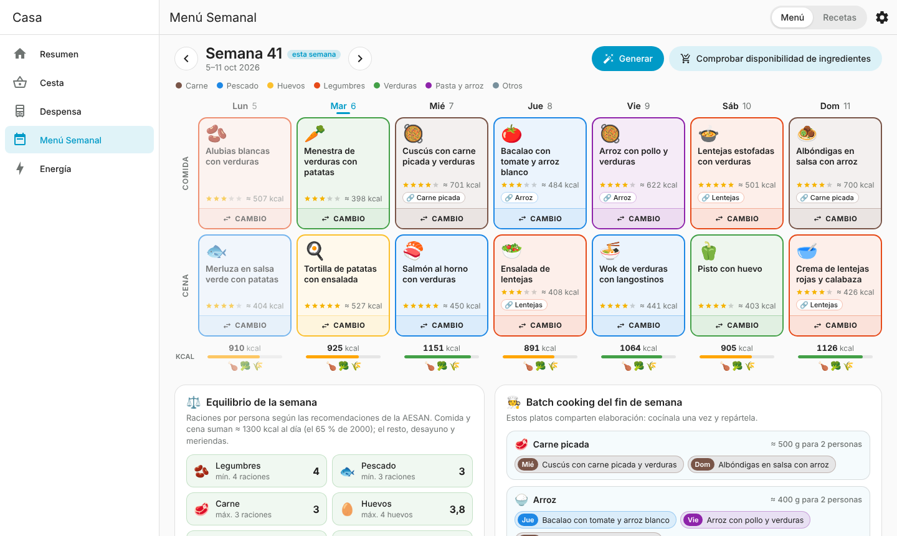

# Menú Semanal

Integración de Home Assistant que planifica las comidas y cenas de la semana con tus propias recetas, equilibradas y pensadas para cocinar el fin de semana (batch cooking). Comprueba en [Despensa](https://github.com/emero03/ha-despensa) si tienes los ingredientes y añade lo que falta a [Cesta](https://github.com/emero03/ha-cesta).

- **Un botón «Generar»**: rellena las 7 comidas y las 7 cenas de la semana de una vez.
- **Vista semanal tipo horario**, con la semana arriba a la izquierda («Semana 41 · 5–11 oct 2026») y flechas para pasar a la anterior o a la siguiente.
- **Botón «CAMBIO» en cada plato**: lo sustituye por otra receta parecida (mismo tipo, calorías similares) sin desequilibrar la semana. Si lo pulsas otra vez, propone otra distinta.
- **Recetas propias**, cada una para comida, cena o las dos, con sus ingredientes, su **valoración de 1 a 5 estrellas** y su **componente principal**, que marca el **color del borde** (carne marrón, verdura verde…).
- **Menú equilibrado**: cada día busca proteína, verdura e hidratos y unas kcal razonables para un adulto; cada semana sigue las raciones recomendadas por la AESAN (legumbres, pescado, carne, huevos).
- **Batch cooking**: junta platos distintos que comparten elaboración (por ejemplo, el lunes cuscús con carne picada y el miércoles albóndigas o espaguetis a la boloñesa) y te dice cuánto cocinar de cada base el fin de semana.
- **«Comprobar disponibilidad de ingredientes»**: compara el menú con la Despensa y abre la lista «Ingredientes que deben agregarse a la cesta». Con **«Añadir»** pasan a la Cesta con su cantidad («2 paquetes»), y al comprarlos la Despensa suma esas unidades.
- **Panel en la barra lateral**, **tarjeta para paneles de control**, **sensores «Comida de hoy» y «Cena de hoy»** y **acciones** para automatizaciones.

Todo se guarda en local, en tu Home Assistant. No usa servicios externos.



`preview/menu-semanal-preview.html` es una demo que se abre en el navegador, sin Home Assistant, con recetas de ejemplo y una Despensa y una Cesta simuladas.

## Cómo se enlaza con Despensa y Cesta

Menú Semanal no modifica ninguna de las dos. Funciona sin ellas, pero con ellas cierra el círculo:

| En Menú Semanal… | Despensa / Cesta |
| --- | --- |
| Pulsas «Comprobar disponibilidad de ingredientes» | Lee el stock de la Despensa (con sus unidades: kg, bricks, latas…) y lo compara con lo que piden las recetas para tus comensales. |
| Pulsas «Añadir» en la lista | Usa la acción `cesta.add_item` con el icono, la sección y la cantidad («2 paquetes», «1 lata», «3 uds»). Lo que ya está en la Cesta no se repite. |
| Marcas esos productos como comprados en la Cesta | La Despensa suma las unidades del detalle (es su comportamiento normal), y la próxima comprobación ya no los pide. |
| Escribes un ingrediente en una receta | Te sugiere los nombres de tu Despensa y del catálogo de Cesta, para que coincidan. |
| Activas «Aprovechar lo que hay en la Despensa» | Al generar, da un poco de preferencia a recetas cuyos ingredientes ya tienes. |

Sin Despensa, la comprobación lista todo lo que pide el menú (salvo lo básico). Sin Cesta, puedes ver la lista pero no añadirla.

## Instalación

### Con HACS (recomendado)

1. Sube esta carpeta a un repositorio de GitHub.
2. En HACS → menú ⋮ → **Repositorios personalizados**, añade la URL del repositorio con el tipo **Integración**.
3. Busca **Menú Semanal** en HACS, instálala y reinicia Home Assistant.
4. Ve a **Ajustes → Dispositivos y servicios → Añadir integración** y busca **Menú Semanal**.

### Manual

1. Copia la carpeta `custom_components/menu_semanal` dentro de `config/custom_components/` de tu Home Assistant.
2. Reinicia Home Assistant.
3. **Ajustes → Dispositivos y servicios → Añadir integración → Menú Semanal**.

Al añadirla aparece **Menú Semanal** en la barra lateral. Requiere Home Assistant 2025.1 o posterior (probada en 2026.2, junto a Despensa 1.0.0 y Cesta 1.0.0).

## Uso

| Gesto | Qué hace |
| --- | --- |
| **‹ ›** junto a «Semana 41» | Semana anterior o siguiente. «Hoy» vuelve a la actual. También con las flechas del teclado. |
| **Generar** | Rellena la semana entera. Respeta los platos fijados (📌) y los huecos libres. Se puede deshacer. |
| **CAMBIO** en un plato | Lo cambia por otra receta parecida. Pulsándolo varias veces vas viendo alternativas. |
| Tocar un plato | Ficha con kcal, ingredientes para tus comensales y con qué otro plato comparte elaboración. Desde ahí: **CAMBIO**, **Elegir otra**, **Fijar**, **Dejar libre** (comer fuera) o **Editar receta**. |
| Tocar un hueco vacío | **Proponer una receta** o **Elegir receta**. |
| **Comprobar disponibilidad de ingredientes** | Abre «Ingredientes que deben agregarse a la cesta», todos marcados. Desmarca lo que no quieras y pulsa **Añadir**. En la semana en curso cuenta desde hoy. |
| Pestaña **Recetas** | Tus recetas con el borde del color de su tipo, sus estrellas y sus kcal. Filtra por comida, cena o tipo; busca por nombre o ingrediente. |
| **Nueva receta** | Nombre, icono, para comida y/o cena, componente principal, estrellas, raciones, ingredientes (g, kg, ml, l, ud, cucharada, cucharadita o al gusto) y, si quieres, una elaboración compartida y la preparación. Las kcal se estiman solas mientras escribes. |
| ⚙️ Ajustes | Comensales, calorías diarias de referencia, batch cooking, aprovechar la Despensa, colores, equivalencias y recetas de ejemplo. |

### Colores

| Componente principal | Color |
| --- | --- |
| 🥩 Carne | marrón |
| 🐟 Pescado | azul |
| 🥚 Huevos | amarillo |
| 🫘 Legumbres | naranja |
| 🥦 Verduras | verde |
| 🍝 Pasta y arroz | morado |
| 🍽️ Otros | gris |

Al crear una receta se sugiere el tipo según sus ingredientes (marcado «auto»); lo puedes cambiar. Los colores se cambian en ⚙️ Ajustes.

### Estrellas

| ★ | Qué significa para el planificador |
| --- | --- |
| ★★★★★ | De las mejores: sale mucho, puede repetirse la semana siguiente e incluso dos veces en la misma semana. |
| ★★★★ | Sale a menudo. |
| ★★★ | Sale de vez en cuando. |
| ★★ | Sale poco y tarda en volver. |
| ★ | Solo de vez en cuando: tarda varias semanas en repetirse. |

## Cómo decide el menú

Al pulsar «Generar» se prueban muchas combinaciones y se queda con la que mejor puntúa:

- **Valoración**: más estrellas, más probable. Lo que comiste en las últimas semanas se penaliza según sus estrellas (una de 1 ★ tarda hasta un mes en volver).
- **Cada día**: comida y cena suman unas 1300 kcal por persona (el 65 % de 2000 kcal; la comida ≈ 35 % y la cena ≈ 30 %, el resto queda para desayuno y meriendas), con al menos ~35 g de proteína, ~250 g de verdura y algo de hidratos, y sin repetir el mismo tipo de plato en comida y cena.
- **Cada semana**, según las recomendaciones de la AESAN para adultos: legumbres al menos 4 raciones, pescado al menos 3, carne como mucho 3 (poca roja y procesada), hasta 4 huevos, y al menos 2 platos de verdura. Las raciones se cuentan por lo que lleva cada plato, no solo por su color: unos garbanzos con bacalao cuentan como legumbre y como pescado.
- **Batch cooking**: suma puntos si dos platos distintos, en días distintos, comparten elaboración. Se detecta sola por los ingredientes (carne picada, pollo, pavo, ternera, cerdo, garbanzos, lentejas, alubias, arroz, quinoa…) o por la «elaboración compartida» que escribas en la receta (por ejemplo, «Sofrito de tomate» o «Pisto»).
- **Variedad**: evita el mismo tipo de plato dos días seguidos y el mismo plato dos veces (salvo las de 5 ★, y nunca el mismo día).

Las kcal y nutrientes son **estimaciones** hechas con una tabla de composición de unos 140 alimentos habituales, con más de 350 nombres y variantes (valores medios por 100 g, tipo BEDCA). Si un ingrediente no está en la tabla, la receta lo indica y puedes poner las kcal por ración a mano.

Debajo del horario verás **Equilibrio de la semana** (las raciones de cada grupo frente al objetivo) y **Batch cooking del fin de semana**: qué bases se comparten y cuánto cocinar, y la lista de platos con sus raciones. Lo que se come de jueves en adelante lleva ❄️: lo cocinado aguanta 3–4 días en la nevera, así que mejor congelarlo.

## Comprobar la Despensa: unidades y equivalencias

La Despensa cuenta unidades con una etiqueta libre y las recetas piden gramos, mililitros o unidades. Para compararlas:

- Si la etiqueta es de peso o volumen (**kg, g, l, ml**…), se convierte directamente.
- Si son unidades (paquetes, latas, bricks, uds…), se usa lo que pesa una: la **equivalencia** que hayas puesto, o la de serie del producto (un paquete de pasta = 500 g, de arroz = 1 kg, una lata de tomate triturado = 400 g, un brick de leche = 1 l…), o lo que pesa una pieza (un huevo, una cebolla, una patata…).
- Si la receta y la Despensa cuentan unidades, se comparan tal cual (2 huevos frente a 6 huevos).
- Si no se puede saber (por ejemplo, «1 bandeja» de salmón), aparece en **«Sin comprobar la cantidad»**: escribe una vez cuántos gramos trae y queda guardado (se ve y se borra en ⚙️ Ajustes).
- Lo básico que no controlas en la Despensa (sal, aceite, especias, vinagre, azúcar, agua) se da por bueno.

Las cantidades que se añaden a la Cesta van en las unidades de tu Despensa («1 paquete», «2 latas», «1 kg»), así que al comprarlas se suman bien.

## Tarjeta para paneles de control

Edita un panel → **Añadir tarjeta** → **Menú Semanal**, o en YAML:

```yaml
type: custom:menu-semanal-card
title: Menú de la semana   # opcional
view: menu                 # opcional: menu (por defecto) o recipes
```

## Sensores

- `sensor.menu_semanal_comida_de_hoy` y `sensor.menu_semanal_cena_de_hoy`: el nombre del plato («Libre» o «Sin planificar» si no hay). Atributos: `icono`, `tipo`, `valoracion`, `kcal_por_racion`, `comensales`, `ingredientes` (ya calculados para tus comensales) y `fijado`.

## Acciones

- `menu_semanal.generate`: `week` (`current` por defecto, `next`, una fecha `2026-10-12` o una semana `2026-W42`). Genera la semana y devuelve el menú.
- `menu_semanal.check_ingredients`: `week`, `add_to_cesta` (`false` por defecto). Devuelve `count`, `missing` (con `need`, `have` y `note`), `unsure`, `in_cesta`, `added` y `text`.
- `menu_semanal.get_menu`: `week` o `day` (`today`/`hoy`, `tomorrow`/`mañana`, un día de la semana o una fecha). Devuelve `days` y `text`.

## Automatizaciones

El sábado por la mañana, generar el menú de la semana que viene, pasar lo que falta a la Cesta y mandártelo:

```yaml
alias: Menú de la semana que viene
triggers:
  - trigger: time
    at: "09:00:00"
conditions:
  - condition: time
    weekday: sat
actions:
  - action: menu_semanal.generate
    data:
      week: next
    response_variable: menu
  - action: menu_semanal.check_ingredients
    data:
      week: next
      add_to_cesta: true
    response_variable: compra
  - action: notify.mobile_app_mi_movil
    data:
      title: "🗓️ Menú listo · {{ compra.count }} cosas a la Cesta"
      message: "{{ menu.text }}"
```

Avisar a media tarde de lo que toca cenar:

```yaml
alias: Qué hay de cena
triggers:
  - trigger: time
    at: "18:30:00"
actions:
  - action: notify.mobile_app_mi_movil
    data:
      title: "🌙 Cena: {{ states('sensor.menu_semanal_cena_de_hoy') }}"
      message: "{{ state_attr('sensor.menu_semanal_cena_de_hoy', 'ingredientes') | join(', ') }}"
```

## Datos

Se guardan en `config/.storage/menu_semanal` y se incluyen en las copias de seguridad de Home Assistant. Se conservan las últimas 16 semanas (para no repetir recetas y como historial). Si eliminas la integración, se borran.

## Desarrollo

```bash
pip install pytest-homeassistant-custom-component
DESPENSA_REPO=../ha-despensa CESTA_REPO=../ha-cesta pytest   # tests; los de Despensa y Cesta se saltan si no están
python3 tools/build_preview.py                                # regenera preview/menu-semanal-preview.html
```

La vista previa usa el mismo `menu-semanal.js` de la integración con un backend simulado (`preview/mock-backend.js`) que copia el planificador de Python con el mismo generador aleatorio: con la misma semilla da exactamente el mismo menú, y un test lo comprueba (necesita Node.js).

Estructura:

```
custom_components/menu_semanal/
  __init__.py          carga, panel lateral, tarjeta y ficheros estáticos
  manager.py           recetas, semanas, ajustes, CAMBIO, deshacer y comprobación
  planner.py           el planificador: puntuación de la semana y búsqueda
  nutrition.py         tabla de alimentos y estimación de kcal, nutrientes y bases
  pantry.py            comparación con la Despensa: unidades, equivalencias y cantidades
  bridge.py            enlace con Despensa (lectura) y Cesta (cesta.add_item)
  examples.py          recetas de ejemplo
  catalog.py           el mismo catálogo de productos que Cesta y Despensa
  websocket.py         API que usa el panel (menu_semanal/*)
  services.py          acciones menu_semanal.*
  sensor.py            sensores «Comida de hoy» y «Cena de hoy»
  config_flow.py       alta desde Dispositivos y servicios
  frontend/menu-semanal.js  panel <menu-semanal-panel> y tarjeta <menu-semanal-card>, sin dependencias
```
